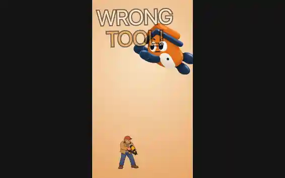
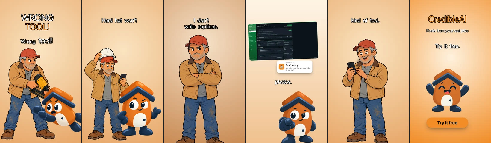

# reel-studio

A [Claude Code](https://claude.com/claude-code) skill that makes short vertical video ads and reels
(Instagram Reels, TikTok, YouTube Shorts, Facebook) with illustrated characters, voiceover, music, sound
effects and captions, for any product. No video model anywhere: the motion is drawn in code, so a reel
re-renders in a minute after one changed line.

<p align="center"></p>

How it works, with the code explained: [I built a Claude Code skill that makes video ads without a video model](https://mahmadmanzoor.com/blog/claude-code-skill-video-ads-no-video-model).

**If it saves you time, please give the repo a star.** It is the easiest way to tell me it is worth
building more of these.

```
brief → style → 5 scripts → character sheet → images → voices → sound effects → music → timeline → render → post caption
```

## Install

```bash
git clone https://github.com/mahmadmanzoor/reel-studio ~/.claude/skills/reel-studio
cd ~/.claude/skills/reel-studio
npm install
npx playwright install chromium
```

Then open Claude Code anywhere and ask for a reel, for example *"make a 15 second Instagram Reel for my
app with two cartoon characters"*. The first run checks your tools with `scripts/doctor.sh` and tells you
what is missing (Codex CLI, ffmpeg, whisper.cpp and so on); see [What it needs](#what-it-needs).

<p align="center"></p>

## What you get

- **A reel you chose at every step.** Each stage ends with your pick: the
  script out of five, the character sheet, the images, a voice per character,
  each sound effect out of five, the track out of five.
- **Picks in the chat.** Music and sound-effect candidates arrive as audio clips
  that play inline, then a picker with the recommended one already selected.
- **Hook variants for A/B tests** on the same body, rendered side by side.
- **Every size from one timeline.** 9:16, plus 1:1 and 4:5 feed versions with
  their own safe zones; text and characters rescale, overrides only where needed.
- **Captions timed to the actual audio**, word by word, by a local whisper.cpp
  run — not guessed from the script.
- **A cover, a no-captions cut, and the post caption** with hashtags per platform.
- **A library that saves money the second time.** Characters (sheet, poses,
  voice), every generated voice line, licensed tracks and effects are kept and
  reused before anything is paid for again.
- **Loudness checked, not assumed:** −14 LUFS, true peak measured *after* the AAC
  encode and the limiter lowered until it is under −1 dB.
- **Ready-made types.** Retro anime suspense is a late-1970s TV anime meme that
  hard-cuts into a real product demo. The story is free; the beats, look, sound and
  motion rules are already decided, in a 31 s or a 42 s cut.

## How a run goes

1. **Tools check, once per computer.** `scripts/doctor.sh` checks everything
   local and writes `tools.md`; later reels skip it. Anything missing is listed
   with its install command and installed after one yes. A missing connector is
   named, with the steps to connect it.
2. **Brief in one message:** product, length (10 s – 2 min), platforms, sizes,
   captions, hook variants, CTA, characters, product screenshots.
3. **Scripts, images, voices** — ChatGPT through the Codex CLI on your plan,
   ElevenLabs for audio. **Before any paid audio you get the credit estimate.**
4. **Music and effects** from the library first, then Envato through your Chrome.
5. **Final cut.** One agent reviews everything the workers made, writes the
   timeline, renders every output and checks frames and loudness before you
   see it.

Everything chosen goes into `reel.json` the moment it is chosen, so a run picks
up in a new session where it stopped.

## What it needs

`scripts/doctor.sh` checks every local row and says the install command for what
is missing.

| | For |
| --- | --- |
| A ChatGPT plan + Codex CLI (`codex login`) | scripts, images — no API key |
| ffmpeg, node 18+, Python with Pillow and numpy, Playwright Chromium | render |
| whisper.cpp + `ggml-small.en.bin` | caption timing |
| ElevenLabs connector (Fish Audio as fallback) | voice, sound effects |
| Envato connector + Envato Elements in Claude in Chrome | music, more effects |

Without ElevenLabs or Fish the reel has no voiceover; without Envato it uses the
library or music you supply. `references/setup.md` has every install step.

## Scripts

| | |
| --- | --- |
| `scripts/doctor.sh` | **First, once.** Tools check → `tools.md` |
| `scripts/codex.sh` | `text` / `image` through the Codex CLI on the ChatGPT plan |
| `scripts/img.py` | `check`, `trim`, `remouth` (open-mouth pose that changes only the mouth) |
| `scripts/words.py` | Word timings from whisper.cpp, aligned to the written line |
| `scripts/music.mjs` | Music/effects library: `find`, `add`, `clips` for the picker, `full`, `use` |
| `scripts/cast.mjs` | Characters, voices and generated lines: `save`, `list`, `use`, `voices`, `line` |
| `scripts/retro-scaffold.mjs` | Retro anime type: writes a timeline that follows the format, and the list of images to make |
| `scripts/hand_screen.py` | Retro anime type: real screenshots in a drawn hand-held phone, and where the tap markers go |
| `scripts/retro-check.mjs` | Retro anime type: fails idle character motion, zooms on talking shots, boxed captions and a music lift that misses the reveal |
| `render.mjs` | `reel.json` → MP4: `--hook N`, `--size 1:1\|4:5`, `--cover`, `--stills`, `--frame t`, `--safe` |

## The library

`library/` is created on first use and is **not in git**: it holds licensed
Envato audio, your characters and paid voice lines, which belong to whoever made
them. Each computer builds its own.

## Read next

`SKILL.md` is the whole method. `LOG.md` is what it got wrong in real use.
`references/` holds the detail: the timeline format, motion rules, prompts,
platform lengths and safe zones, the picker, parallel agents, setup.

## Proven on

[CredibleAI](https://credibley.com) — a 15 s humor skit with two characters, two hook variants, captions,
three sound effects and a licensed track, rendered at 9:16, 1:1 and 4:5.

A mobile app — two retro anime suspense reels, one in each cut.

## License

MIT. Licensed music, sound effects, characters and voice lines you make with it stay in `library/`, which is
not in git, and belong to whoever made or licensed them.

If you use it, I would love to see what you make. And if it helped, a star helps others find it.
